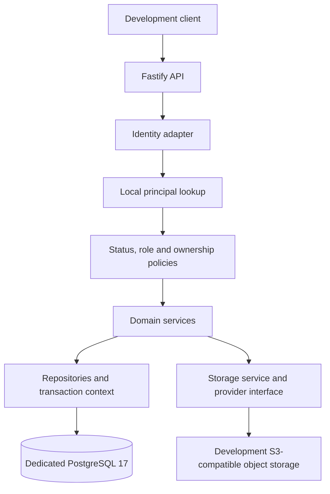
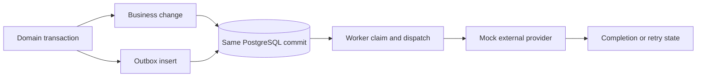

# Backend architecture

Status: Phase 2 design contract, 2026-10-27. Runtime implementation and independent acceptance require separate evidence. This documentation does not declare Phase 2 PASS.

## Authority and isolation

The [Phase1G final report](../migration/PHASE1G_FINAL_REPORT.md) supersedes Phase1F's blocked build admission. Its approval covers isolated construction with synthetic fixtures only. Production cutover remains unapproved; its reported score remains 52/100.

Binding inputs:

- [Migration audit](../../SUPABASE_MIGRATION_AUDIT.md) and [Phase1F final report](../migration/PHASE1F_FINAL_REPORT.md): historical findings and unresolved production risks.
- [Database contract](../migration/PHASE1G_DATABASE_EXTRACTION_CONTRACT.md), [Auth contract](../migration/PHASE1G_AUTH_INCLUSION_CONTRACT.md), and [Storage contract](../migration/PHASE1G_STORAGE_INCLUSION_CONTRACT.md): selection and compatibility rules.
- [Function replacement map](../migration/PHASE1G_FUNCTION_REPLACEMENT_MAP.md): future replacement responsibilities.
- [Phase 2 boundary](../migration/PHASE1G_PHASE2_BOUNDARY.md) and [independent QA](../migration/PHASE1G_INDEPENDENT_QA.md): mandatory containment and evidence limits.

No production contact is needed for these documents or foundation development. Do not contact `supabase.carubra.space`, `20.20.20.3`, legacy `supabase.carubra.com`, or `20.20.20.173`. No SSH, Supabase deployment, production credentials, users, sessions, financial rows, media, settings, or provider callbacks enter this phase. Existing frontend production routing stays unchanged. Gallery stays disabled; synthetic placeholders are sufficient.

## Decisions

| Concern | Decision and reason |
| --- | --- |
| Architecture | TypeScript modular monolith; one codebase, explicit module ownership, API and worker processes |
| Runtime | Node.js 22 LTS in current Docker design; backend package supports `>=22 <25` |
| HTTP | Fastify, JSON Schema validation, REST under `/api/v1`, generated OpenAPI |
| Persistence | Dedicated PostgreSQL 17; SQL-first migrations, connection pool, explicit transaction context |
| Queue | PostgreSQL transactional outbox; no Redis requirement |
| Identity | Local mock/dev provider plus application identity mapping; no homemade password/JWT system |
| Object storage | Dedicated development S3-compatible object storage through provider-independent storage interface |
| Providers | Local mocks; real SMTP, Xendit, Google, Keycloak, GCS, Spotify and analytics disabled |
| Packaging | Isolated `backend/` package beside existing frontend; no unrelated frontend restructure |

## Request and asynchronous flows

Routes validate transport input and invoke services. Services authorize against current local state and own transaction boundaries. Repositories use parameterized SQL and accept the same transaction client. External I/O happens outside business transactions; workers receive committed events. Storage authorization occurs before issuing any capability URL.

## Compatibility without importing production

Application user UUIDs remain independent of provider subjects. Future imports preserve selected source UUIDs. Typed non-login identity references preserve historical relationships without creating accounts. Storage identity is provider/bucket/key plus logical links, never a saved signed URL. Existing seven-role vocabulary is retained for compatibility; undefined permissions stay denied. See [database design](DATABASE_DESIGN.md), [Auth](AUTH_DESIGN.md), [authorization](AUTHORIZATION_MODEL.md), and [Storage](STORAGE_DESIGN.md).

The 33-table source catalog is a reviewed compatibility baseline, not permission to replay shared Supabase DDL, ACLs, triggers, or credentials. Foundation system tables and representative slices do not prove complete domain schema or application parity. Any unbuilt compatibility item must remain explicit in implementation reports.

## Integration and acceptance checklist

- [ ] Dedicated PostgreSQL and S3-compatible object storage, credentials, networks and volumes; no production dependency.
- [ ] Fresh migrations, checksum/history, runtime grants and negative database access verified.
- [ ] DB-backed `/api/v1/me`; current status/roles and explicit superadmin hierarchy wired through shared policies.
- [ ] User, admin, Storage and asynchronous representative slices exercised end to end.
- [ ] Private Storage, raw-body webhook authentication, replay defense and durable deduplication verified.
- [ ] Worker crash recovery, retries, dead-letter behavior and idempotent mock effects verified.
- [ ] Health/readiness, structured logs, metrics, OpenAPI and Docker verified.
- [ ] All gates in [test strategy](PHASE2_TEST_STRATEGY.md) independently executed; evidence recorded separately.

Unchecked items are acceptance requirements, not findings that a completed implementation necessarily lacks them. Documentation authors do not grant runtime acceptance. Agent H independently verifies behavior; coordinator reconciles results before any Phase 3 recommendation.

